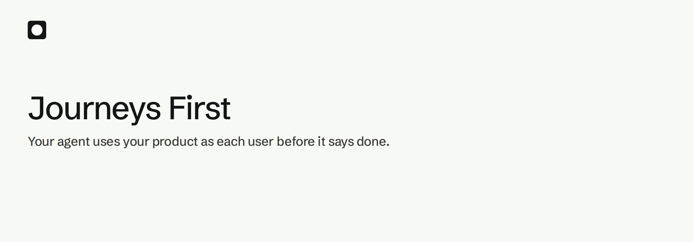

<p align="center">
  
</p>

# Journeys First

[](https://www.npmjs.com/package/journeysfirst)
[](CHANGELOG.md)
[](https://github.com/santorilabs/journeysfirst/actions/workflows/test.yml)
[](LICENSE)
[](https://skills.sh/santorilabs/journeysfirst)

Agents build your product, and **agents now use it too.**

An open format and skills for writing the contracts your product keeps: what each user, person or agent, must be able to do. 
Your agents build to them, and check their work against what your users experience.

- **Format:** journeys in plain sentences, and a run file with proof for every check.
- **Skills:** onboard, build, write, run, review, fix.
- **Runner:** replays each journey as a Playwright test.
- **Review page:** watch each run step by step, as each user.

Everything lives in your repo and runs wherever your code runs: your machine, CI or your own cloud.

## The problem

Tests are not enough for verification, so you ask your agents to verify and show you proof. You get screenshots and videos, but it's still not enough.

Models are trained to finish the task in front of them. Left on their own, they [say it's done when it isn't](https://metr.org/blog/2025-06-05-recent-reward-hacking/), or get it done by [breaking something else](https://metr.org/notes/2026-03-10-many-swe-bench-passing-prs-would-not-be-merged-into-main/).

- **Your agent picks what to check.** It checks the task you gave it. Nothing tells it what else your product has to keep doing. So you get regressions (no test failures, but real user experience failures).
- **It checks as that one user,** the one in the task. Other users that are affected, people or agents, don't get checked. Other relevant user journeys are often skipped too.
- **The proof isn't kept as a check.** Your next change isn't held to it.

We built this to automate most of our product development without worrying about user experience regressions.

## Where it fits

Journeys First works on top of what you already have: your tests, your agent's own checks, and Playwright. It fills 2 gaps:

- **Every affected user, including agents.** A journey names every user a change affects and checks each from their own login.
- **A contract over one-time proof.** A journey says what each user should get, not which buttons to click. It stays in your repo, and every run keeps proof for every check.

| Kind | Examples | What it does | Limits |
|---|---|---|---|
| Self-check skills | [pstack](https://github.com/cursor/plugins/tree/main/pstack), [Showboat](https://github.com/simonw/showboat) | Agents drive your app from a feature map and show you proof. | Describes each feature from one user's point of view. Every rerun is a full agent run. |
| Check-and-save tools | [Shiplight](https://www.shiplight.ai/yaml-tests), [Playwright test agents](https://playwright.dev/docs/test-agents) | Agents turn their check into a test that runs on every PR. | Browser tests only, so no agent as a user. |
| Test code | [Playwright](https://playwright.dev/docs/browser-contexts), [Cucumber](https://cucumber.io/docs/gherkin/) | Tests several users in one test. | Fixed code checks of each step. They break when the UI changes, so someone keeps updating them. |
| AI QA services | [QA Wolf](https://docs.qawolf.com/why-qa-wolf), [QA.tech](https://qa.tech/use-cases/multi-user-testing) | Test your app for you, with several users. | Your agent can't use it while it builds. External service. |
| Spec tools | [Spec Kit](https://github.com/github/spec-kit), [Kiro](https://kiro.dev/docs/specs/correctness/) | Write down what to build. | Agents build and verify against the current task, not everything your product promises. |
| MCP eval tools | [promptfoo](https://www.promptfoo.dev/docs/providers/mcp/), [mcp-eval](https://github.com/lastmile-ai/mcp-eval) | Test your MCP server on its own. | Check the agent's side only, not what people see after. |

## A journey is the contract

A journey is a contract anchored on the user experience. It lives in your repo, so your agents use it from building the product to verifying it.

A journey proves your change. Then it stays, and every later change is held to it.

Your agent can turn it into code checks so it runs faster, and read the run logs to speed up later runs, for example by writing code helpers. But the journey stays the promise you keep to your users.

## When to use

It's most useful for production apps that are more complex: several kinds of users, agents using it through MCP, and flows that depend on each other.

- **Changes to production apps:** we tested agents adding a new feature to an existing open source app with several kinds of users. Agents with journeys verified as every user role in 3 of 3 runs and kept a video in 2, against 1 of 3 and none without. We also replayed 2 real bugs from Immich and Docmost, and agents with journeys caught both regressions.
- **New apps from 1 prompt:** without Journeys First, agents said done without opening the app, and 2 of 6 apps shipped unclickable. With it, the agent opened and used each app as each user first.

It costs more: builds took 3 to 4 times longer and cost 3 to 4 times as much. [All results](docs/results.md).

## Example

A real run: your agent books a meeting through an MCP server, then you and your teammate each check your own calendar. [Watch it (30 s)](assets/review.mp4).

The journey, `journeys/book-through-mcp.journey.yaml`:

```yaml
format: journeysfirst/v1
title: Book a meeting through the MCP server
promise: Your agent can book a meeting with a teammate through our MCP server, and you both see it on your calendars.
users: [agent, teammate]   # "you" is always there, so only the others are listed
start: Your calendar and your teammate's are empty tomorrow at 10. Your agent is connected to our MCP server.
steps:
  - You ask your agent to book 30 minutes with your teammate tomorrow at 10.
  - The agent books the meeting through the MCP server.
  - check: The agent's answer to you matches what was saved.
    id: answer-matches   # added by your agent; stays the same if you reword the check
  - You open your calendar.
  - check: You see the meeting tomorrow at 10, with your teammate invited.
    id: you-see-it
  - Your teammate opens their calendar.
  - check: Your teammate sees the same meeting tomorrow at 10.
    id: teammate-sees-it
```

You write it in plain sentences, with no selectors or URLs. Your agent works those out when it runs it, and saves them in a script. Every run keeps the proof: a screenshot for each line, a video for each user, and a [`run.json`](spec/run-results-v1.example.json) with every check.

https://github.com/user-attachments/assets/8d8912ba-3d1c-472b-a1af-b98645e558f5

## Install

Ask your agent to do it. Copy this to your agent:

```text
Set up Journeys First in this repo: https://journeysfirst.com/start
```

It tells you its plan first, and stops before it runs anything.

Or do it yourself (Node 20 or newer):

```bash
npm install --save-dev journeysfirst @playwright/test
npx playwright install --only-shell chromium
npx journeysfirst init
```

On a repo with no dev or start script, init adds an example page, a journey and a script. `npx playwright test` then passes. Point `webServer` at your app when you replace the example. `npx journeysfirst init --demo` adds that example even when the repo has a dev script.

Or only the skills: `npx skills add santorilabs/journeysfirst --skill '*' --agent claude-code codex -y`

## Try it

Want to see it catch something? The example app has a bug you can turn on: the link keeps working after you turn sharing off.

```bash
git clone https://github.com/santorilabs/journeysfirst.git
cd journeysfirst && npm install && npx playwright install --only-shell chromium
cd examples/share-by-link
npm test           # passes
npm run test:bug   # fails: the viewer still sees the deck
npx journeysfirst review journey-runs   # both runs at http://127.0.0.1:4400
```

## Use it

Just ask your agent. It picks the right skill:

| Ask your agent | Skill |
|---|---|
| "Set up Journeys First here." | [journey-onboard](skills/journey-onboard/SKILL.md) |
| "Build a site where study groups share notes." | [journey-build](skills/journey-build/SKILL.md) |
| "Write a journey for inviting a teammate." | [journey-write](skills/journey-write/SKILL.md) |
| "Run the journeys this change touches." | [journey-run](skills/journey-run/SKILL.md) |
| "Review the last run." | [journey-review](skills/journey-review/SKILL.md) |
| "That run failed. Fix it." | [journey-fix](skills/journey-fix/SKILL.md) |

After the first run, a replay is a plain Playwright test: `npx playwright test`. It needs no model, unless one of the users is an agent. `npx journeysfirst doctor` checks Node, Playwright, Chromium, the config, the app's address and each journey file. For every command, run `npx journeysfirst --help`.

## Limitations

- It's 0.0.x, so things may still break between releases.
- It only runs web apps for now.
- You set up the test accounts and start states. Onboarding tells you what it needs.
- Onboarding drafts your top journeys, so it can miss one, like a single privacy setting. You or your agent add the rest as you work.
- Your agent writes the check code, so read the checks in review like you would any test.

## More

[Overview](docs/overview.md) · [Journey format](spec/journey-format-v1.md) · [Run results](spec/run-results-v1.md) · [How the code fits](docs/how-it-fits.md) · [Run in code](docs/run-in-code.md) · [Publish a run](docs/publish.md) · [Contributing](CONTRIBUTING.md) · [Security](SECURITY.md) · [Changelog](CHANGELOG.md)

If a journey catches a bug in your app, or misses one, [open an issue](https://github.com/santorilabs/journeysfirst/issues/new/choose) with the journey.
