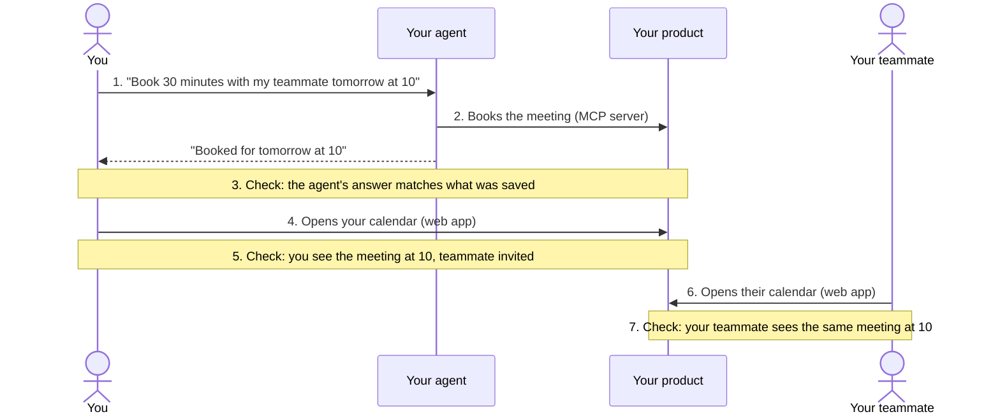

# Overview

How [Journeys First](../README.md) runs a journey, what a journey and a run look like, and how it compares.

## What setup changes in your repo

- `package.json`: adds `journeysfirst` and `@playwright/test` as dev dependencies.
- Skills in your agent's skills folder: `.agents/skills/` and `.claude/skills/`.
- `playwright.config.js`, only if you have none.
- `.gitignore`: ignores `journey-runs/`.
- After approval, a short Journeys section in the project's agent instructions.
- `.github/workflows/journeysfirst-upgrade.yml`: opens a pull request when a new version is out.
- `journeys/`: init creates it for your journey files. Later, onboarding adds your app's own skill.

To undo it, revert those files. Nothing is installed outside your repo except Playwright's browser.

## How runs work

- **Browser:** your agent runs the journey with its own tools and saves a Playwright script in `e2e/`. Replay it with `npx playwright test`, locally or in CI. It needs no model unless one of the users is an agent.
- **Terminal and MCP:** run `npx journeysfirst run journeys/<name>.journey.yaml` to launch a supported agent CLI. Use command output or replies recorded through the MCP proxy as evidence. See [agent runner setup](run-in-code.md#let-an-agent-run-a-journey).
- **Checks in the saved script are code:** an API read, a database query, the sent message. A model only judges during a live agent run.
- **When the product changes and a replay breaks:** the `journey-fix` skill tells a stale script from a product bug. The agent updates the script, never the check. The skill says: "Never weaken a check to make a run pass."
- **When a real agent is one of the users:** its path can change, so run the journey several times. For a browser replay, use `npx playwright test --repeat-each=5`. The run list shows "4 of 5 runs passed".
- **Logins and test data:** `journey-onboard` lists what your app needs (test accounts, start states) and writes one app skill your agent reads before each run.

## Two journeys

**An agent and two people.** Your agent books through your MCP server, then you and a teammate each check your own calendar. Each check sits with the user whose view it is about.



The file, `journeys/book-through-mcp.journey.yaml`:

```yaml
format: journeysfirst/v1
title: Book a meeting through the MCP server
promise: Your agent can book a meeting with a teammate through our MCP server, and you both see it on your calendars.
users: [agent, teammate]   # "you" is always there, so only the others are listed
start: Your calendar and your teammate's are empty tomorrow at 10. Your agent is connected to our MCP server.
steps:
  - You ask your agent to book 30 minutes with your teammate tomorrow at 10.
  - The agent books the meeting through the MCP server.
  - check: The agent's answer to you matches what was saved.
    id: answer-matches   # added by your agent; stays the same if you reword the check
  - You open your calendar.
  - check: You see the meeting tomorrow at 10, with your teammate invited.
    id: you-see-it
  - Your teammate opens their calendar.
  - check: Your teammate sees the same meeting tomorrow at 10.
    id: teammate-sees-it
```

**Two people in a browser.** You share a deck by link, a viewer opens it, then you turn the link off. From [examples/share-by-link](../examples/share-by-link), a demo app you can run:

```yaml
format: journeysfirst/v1
title: Share a presentation by link
promise: You can share a presentation by link, and turn the link off again.
users: [viewer]
start: You have a presentation called "Q3 plan". Link sharing is off.
steps:
  - Turn on link sharing and send the link to the viewer.
  - check: Link sharing is still on after a reload.
    id: link-on
  - The viewer opens the link.
  - check: The viewer sees "Q3 plan".
    id: viewer-sees-it
  - Turn off link sharing.
  - The viewer opens the link again.
  - check: The viewer can no longer see "Q3 plan".
    id: viewer-blocked
```

- `promise` is the person's own words. Each `check:` is something that must be true at that point. Its `id` stays the same when you reword the check, so its history carries over.
- "You" is the main user. `users` lists the others, people or agents. Each check is proven from the view of the user it names.
- No selectors, URLs or proof. Your agent's script holds the first two, the run holds the proof. Full format: [journey format v1](../spec/journey-format-v1.md).

## A run

A run is one folder: `run.json` plus the screenshots and videos it points to.

- Each check has a verdict (`passed`, `failed`, `blocked`, `not_checked`), a one-sentence `proof` and its `evidence`.
- A failed or blocked step names a `cause`: `product`, `test` or `environment`.
- Full format: [run results v1](../spec/run-results-v1.md).

## Try the example app

You need Node 20.15 or newer on the 20 line, or Node 22.2 or newer.

```bash
git clone https://github.com/santorilabs/journeysfirst.git
cd journeysfirst
npm install
npx playwright install --only-shell chromium
cd examples/share-by-link
npm test                      # one passing run
npm run test:bug              # one failing run: the demo app keeps the link working after sharing is off
```

Each run lands in `examples/share-by-link/journey-runs/share-by-link/<run id>/`: `run.json`, a screenshot per line (`step-<n>.png`) and a video per user (`you.webm`, `viewer.webm`).

Still in `examples/share-by-link`:

```bash
npx journeysfirst validate journeys/share-by-link.journey.yaml    # check a journey; problems name their line
npx journeysfirst validate-run journey-runs/share-by-link/<run id> # check a run, and that its steps match the journey
npx journeysfirst review journey-runs                             # browse runs on a local page, at http://127.0.0.1:4400 (this machine only)
```

## The spec

| Doc | What it defines |
|---|---|
| [Journey format v1](../spec/journey-format-v1.md) | The journey file: what must be true, in plain sentences. |
| [Run results v1](../spec/run-results-v1.md) | One run of a journey: what each user did, what was seen, and how each check was proven. |

## How the parts fit

[How it fits](how-it-fits.md) explains the code in four layers: format, runner, publish and review.

More: [Run a journey in code](run-in-code.md) (Playwright and the recorder), [Publish a run](publish.md) (send a run to a service, and the API).

## What is stable

The two v1 formats, the CLI, `journeysfirst`, `journeysfirst/playwright`, `journeysfirst/reporter`, `journeysfirst/recorder` and `journeysfirst/publish` are the parts to build on.  [Stability](how-it-fits.md#stability) lists every entry point and its group.

## Upgrades

After installing a new version, `npx journeysfirst upgrade` refreshes the copied skills. To get each new release as a pull request that merges itself when the journeys pass, see [Upgrades that merge themselves](auto-upgrade.md).
