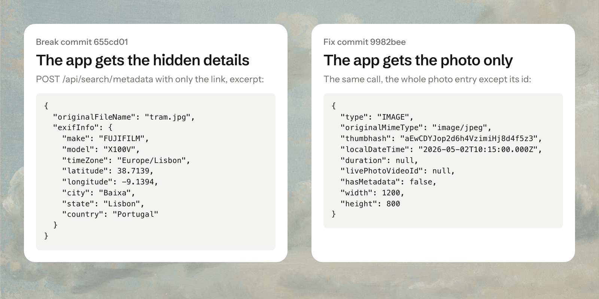
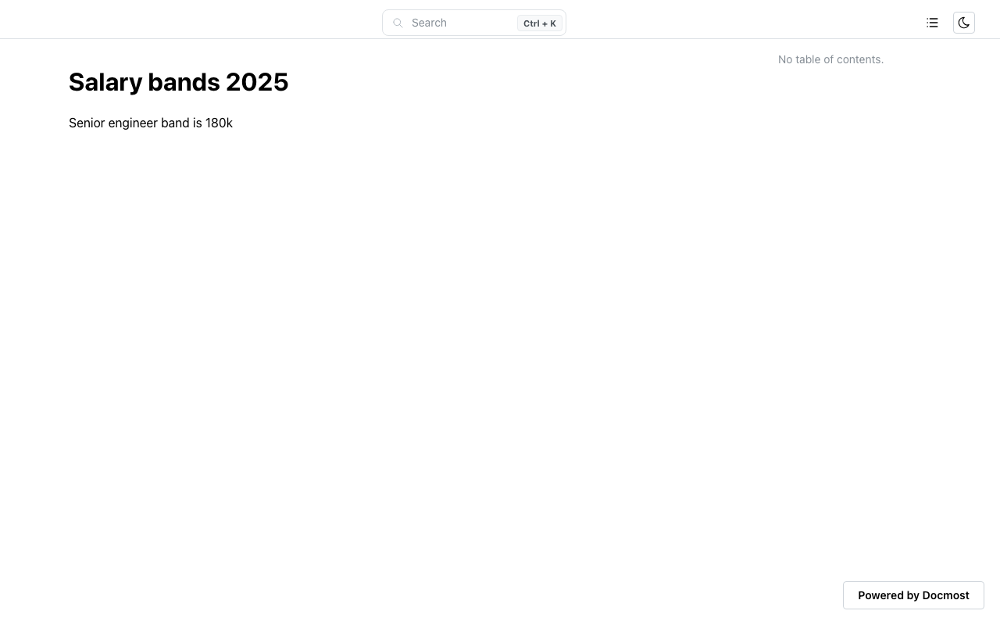

# Results

3 small tests. Early signs, not a benchmark.

## 1. Adding a feature to an existing app

**Setup.** Codex added shift handoffs to [Chatwoot](https://github.com/chatwoot/chatwoot): an AI agent leaves a private summary, and the next teammate sees it. The task never mentioned the customer. 3 runs with Journeys First, 3 without.

**Result.** Every agent kept the summary private. They differed in checking the customer's side:

| The agent checked | Without | With |
|---|---|---|
| The customer can't see the summary | 3 of 3 | 3 of 3 |
| The customer still sees their own message | 1 of 3 | 3 of 3 |
| Both, with a video of what the customer saw | 0 of 3 | 2 of 3 |

**Limits.** 1 task. The Journeys First side started with 1 journey and an app skill written.

## 2. Building a new app from 1 prompt

**Setup.** Claude Code built 2 [WebGen-Bench](https://github.com/mnluzimu/WebGen-Bench) prompts, a study group site and a social site, 3 times with Journeys First and 3 times without. A separate agent then used each app as 2 people.

**Result.** Without Journeys First, agents said done without opening the app, and 2 of 6 apps could not be clicked: an empty layer covered every page. With it, the agent opened and used each app as each user first, and all 6 could be used.

**Limits.** Builds took 3 to 4 times longer and cost 3 to 4 times as much. The apps were not better overall: 2 study group apps lost their data on restart.

## 3. Replaying real regressions

**Setup.** 2 changes in open source apps that worked for the person they were built for and broke something for someone else. We wrote a journey from the other person's side and ran it on the change and on the fix.

**Result.** The journey failed on both changes and passed on both fixes.

- **Immich.** A photo frame app could read a shared album by its link and get each photo's GPS, camera and file name, with "Show metadata" off. CI passed. [Run it](../examples/immich-shared-link).

  

- **Docmost.** Deleted pages went to a trash, but their public link still showed them, and teammates still found them in search. [Run it](../examples/docmost-trash).

  | After the page went to trash | After the fix |
  |---|---|
  |  |  |

**Limits.** We wrote each journey after we knew the bug.
