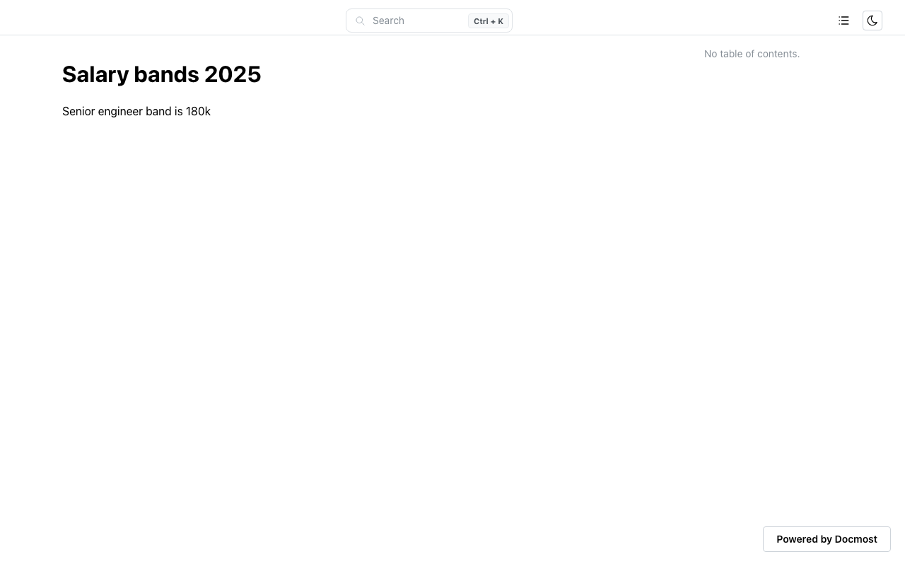
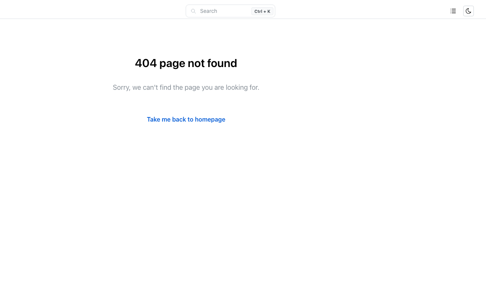
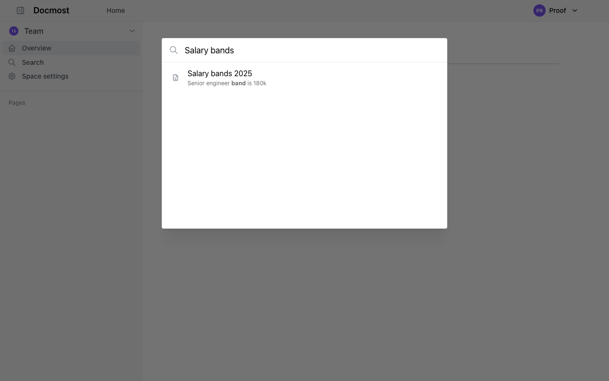

# Docmost: a page in Trash stays readable to everyone else

A real bug in [Docmost](https://github.com/docmost/docmost), a team wiki, and the journey that catches it. The same journey and script fail on the commit that broke the promise and pass on the commit that fixed it.

## What Docmost promised

Before Trash existed, deleting a page removed it. Its public link stopped working and search stopped finding it. After delete became "move to Trash", only people who manage the Trash should still see the page.

## What broke

- Breaking PR: [docmost/docmost#325](https://github.com/docmost/docmost/pull/325) "feat: trash for deleted pages in space". Merge commit `ec12e80423b5048dc67f144ddc6960daf3e604a4`. Delete now sets `deletedAt` instead of removing the row. Public shares, search and the Trash list did not filter on `deletedAt`. The PR shows no CI checks and has no tests for search, shares or comments on trashed pages.
- Fix PRs: [docmost/docmost#1439](https://github.com/docmost/docmost/pull/1439) "fix trash in search" and [docmost/docmost#1445](https://github.com/docmost/docmost/pull/1445) "fix: hide trash from can view permission". Fix commit `95b7be61df95ce4a2199d055cbec74dca3f080be`, the merge of #1445, which includes #1439. #325 merged on 2025-07-29. #1439 merged 3 days later and #1445 6 days later. The fix commit is 28 commits after the break commit.

## What each user saw

On the breaking commit:

- **You, who deleted the page**, saw it leave the sidebar and appear in Trash.
- **The viewer**, signed out with the public link, still read the full page.
- **The teammate**, with "Can view" in the space, still found the page in search, and could open the space's Trash and see it there.

On the fix commit, the viewer got "404 page not found", the teammate's search said "No results found", and the Trash list returned 403 to the teammate.

| Break: the viewer, after the page went to Trash | Fix: the same link |
|---|---|
|  |  |

On the breaking commit, the teammate's search still lists the trashed page:



## The journey

An agent that knew the bug and the fix wrote this journey, from the side of the user the bug hurt. The example shows that such a journey catches the break on replay. It does not show that an agent found the bug unprompted.

[`journeys/trashed-page-stays-hidden.journey.yaml`](journeys/trashed-page-stays-hidden.journey.yaml). It has three users. The first two checks prove the viewer and the teammate could read the page before the delete, so a later "cannot see" comes from the delete.

| Check | Break `ec12e80` | Fix `95b7be6` |
|---|---|---|
| `viewer-reads-before` | passed | passed |
| `teammate-finds-before` | passed | passed |
| `in-trash` | passed | passed |
| `viewer-blocked` | **failed**: the page shows; `shares/page-info` returns 200 | passed: 404 |
| `teammate-search-hidden` | **failed**: `/api/search` returns the page | passed: no results |
| `teammate-no-trash` | **failed**: the teammate's Trash lists the page | passed: 403 |

Files:

- [`journeys/README.md`](journeys/README.md): who the users are and what good means.
- [`tests/trashed-page-stays-hidden.spec.js`](tests/trashed-page-stays-hidden.spec.js): the Playwright script. It makes the start state through Docmost's own API: workspace setup, a space, a Markdown page import ([`tests/salary-bands-2025.md`](tests/salary-bands-2025.md)), an invite read from the local mail sink, and a public share. Delete, search and Trash are done in the browser.
- [`stack.sh`](stack.sh): builds an image for a commit if needed, then starts Docmost, Postgres, Redis and Mailpit.
- [`Dockerfile.proof`](Dockerfile.proof): the build used for both commits. See the caveats.

## Run it

You need Docker, git and Node 20 or newer. This example is not part of the repo's `npm test`.

From a clone of this repo:

```bash
npm install                                   # at the repo root; the example uses the local journeysfirst
npx playwright install --only-shell chromium
cd examples/docmost-trash
npm run test:break   # fails: 3 of 6 checks passed
npm run test:fix     # passes: 6 of 6
npm run down         # removes the containers
npx journeysfirst review journey-runs
```

The first `test:break` and `test:fix` each clone Docmost at their commit and build an image. Later runs reuse the image and start from an empty database.

## Time

- Each recorded run took about 37 seconds.
- Building both images took about 8 minutes once the build worked.
- Setting this up the first time took about 50 minutes, from cloning to the first valid run. Writing the journey and the script took about 15 minutes of that. Most of the rest was image builds and the build problem below.

## Caveats

- **The breaking commit does not build with Docmost's own Dockerfile.** #325 added an import in `apps/client/src/components/common/user-info.tsx` that the client's `tsc` type check cannot resolve. Commit `ca837123` fixed it two days later. `Dockerfile.proof` differs from Docmost's Dockerfile in one line: it builds editor-ext, then the server, then runs `vite build` for the client. It skips the client's `tsc` type check, as `pnpm dev` does. Both commits are built with it.
- Mail goes to a local Mailpit on port 8325. Telemetry is off. Ports bind to 127.0.0.1. Accounts are fresh `example.test` addresses.
- Comments on trashed pages, restore and delete for good are not tested.
