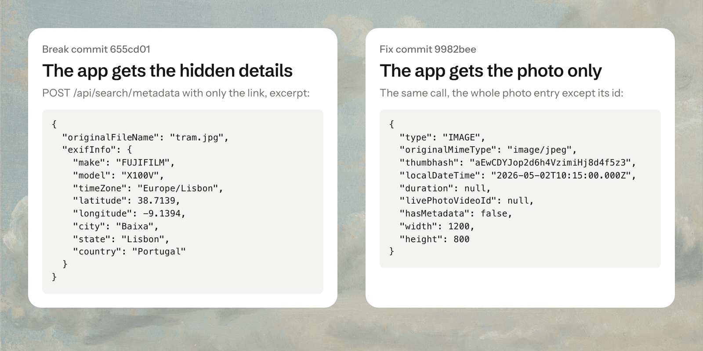

# Immich: a shared link gives away photo details the owner hid

A real bug in [Immich](https://github.com/immich-app/immich), a self-hosted photo library, and the journey that catches it. The same journey and script fail on the commit that broke the promise and pass on the commit that fixed it.

## What Immich promised

An owner can share an album by link with "Show metadata" turned off. People with the link see the photos. They do not see where a photo was taken, the camera or the file name.

## What broke

- Breaking PR: [immich-app/immich#29742](https://github.com/immich-app/immich/pull/29742) "fix: search metadata for album shared links". Merge commit `655cd01d57c7806c4547d6ac47f4f827027caa27`. It let a shared link call `POST /api/search/metadata`, so photo frame apps could list an album. A photo frame app's author asked for it in [#29692](https://github.com/immich-app/immich/issues/29692).
- Fix PR: [immich-app/immich#32561](https://github.com/immich-app/immich/pull/32561) "fix(server): apply shared link metadata visibility in asset mapper". Merge commit `9982bee7b04c1abf4c05ad6d811ea2be23573f8b`.
- Immich's advisory: [GHSA-gjj9-fvfp-jw63](https://github.com/immich-app/immich/security/advisories/GHSA-gjj9-fvfp-jw63): the "Show metadata" setting was not applied to `POST /search/metadata`, so EXIF and GPS leaked. The fix is in Immich v3.4.0.
- CI passed on the breaking PR (51 checks passed, 10 skipped). Its tests checked that search works with a link. No test used a link with metadata hidden. The fix merged about 3 months later.

## What each user saw

On the breaking commit:

- **The viewer, in a browser**, saw the photo with no details. The page looked right.
- **The viewer's photo frame app**, with only the link, got the file name and full EXIF from `POST /api/search/metadata`: camera "FUJIFILM X100V", latitude 38.7139, longitude -9.1394, city "Baixa", country "Portugal". Every other route the app called already hid these details.
- **The owner** saw "Show metadata" still off.

On the fix commit, the same search returned only the id, type, mime type, thumbhash, date, size and `hasMetadata: false`.



The viewer's page on the breaking commit shows the photo and no details. This is why the leak looked fine in a browser:


## The journey

[`journeys/share-album-hide-details.journey.yaml`](journeys/share-album-hide-details.journey.yaml). The viewer is one user who comes in two ways: a browser and an app that reads the album through the API. The script does not aim at one endpoint. With only the link, the app reads the album every way the API offers, then looks for the hidden details in every response.

| Check | Break `655cd01` | Fix `9982bee` |
|---|---|---|
| `link-hides-metadata` | passed | passed |
| `viewer-sees-photo` | passed | passed |
| `page-hides-details` | passed | passed |
| `app-gets-photo` | passed | passed |
| `app-hides-details` | **failed**: 9 hidden details from `POST /search/metadata` | passed |

Files:

- [`journeys/README.md`](journeys/README.md): who the users are and what good means.
- [`tests/share-album-hide-details.spec.js`](tests/share-album-hide-details.spec.js): the Playwright script.
- [`fixtures/tram.jpg`](fixtures/tram.jpg): a test photo with Lisbon GPS and camera EXIF, made by [`scripts/make_photo.py`](scripts/make_photo.py).
- [`stack.sh`](stack.sh): starts Immich for one commit (`up <sha>`) or removes it (`down`).

## Run it

You need Docker and a [supported Node version](../../README.md#install). This example is not part of the repo's `npm test`. Give Docker room: one start here was killed for memory in an 8 GB VM that other containers shared.

From a clone of this repo:

```bash
npm install                                   # at the repo root; the example uses the local journeysfirst
npx playwright install --only-shell chromium
cd examples/immich-shared-link
npm run test:break   # fails: app-hides-details
npm run test:fix     # passes, 5 of 5 checks
npm run down         # removes the containers
npx journeysfirst review journey-runs
```

Each `test:` script starts Immich for its commit from an empty database, then runs the script. The script reads `/api/server/about` first and stops if the running commit is not the one it was given.

## Time

- Each recorded run took 25 to 34 seconds.
- Starting the stack can take minutes on a new server, because Immich imports place names before it reads photo details. `stack.sh` waits for that.
- Setting this up the first time took about 40 minutes, from the first clone to the last run. About half of that was waiting for image pulls and that first import.

## Caveats

- The app is not built from source. `stack.sh` runs Immich's own per-commit CI images (`ghcr.io/immich-app/immich-server:commit-<sha>`), which Immich publishes for each merge commit.
- Machine learning is off and no mail server is set, so the app sends nothing out. Accounts are made by the script, all at `example.test`.
- On the fix commit, someone with the link still gets the owner's email and name from `GET /api/albums/:id`. Immich fixed that later, in [#32607](https://github.com/immich-app/immich/pull/32607). This journey does not check it, because "Show metadata" does not promise to hide the owner.
- Password-protected links and single-photo links were not run.
